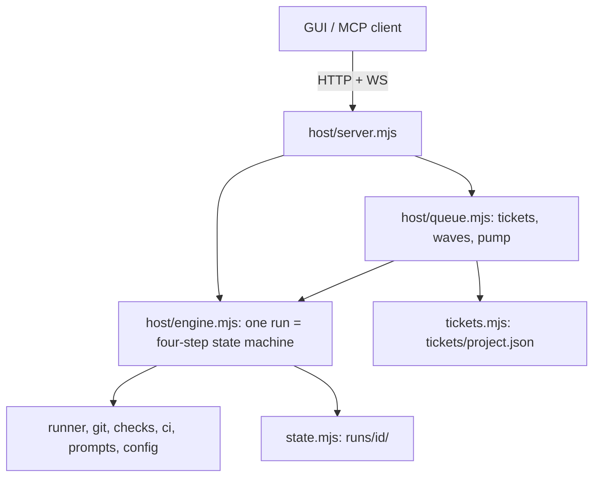

# nano-cycle architecture

How the system works now, and why. Written for a future maintainer. The
README covers usage, deployment and the user-visible workflow; this file covers
the contracts and invariants you must not break. Open problems live in
[KNOWN-ISSUES.md](KNOWN-ISSUES.md).

## 0. The benchmark: the omni-isp Claude Code workflow

nano-cycle exists because of a hand-built Claude Code workflow in
`omni-isp/.claude/` (committed there; `omni-isp/.pi/` is a pi port of the same
skills). It is the bar this project has to clear: if nano-cycle cannot beat
"one strong agent plus these skills", the skills are the product, not the
orchestrator. The toolchain is deliberately **not** copied here; omni-isp stays
the source of truth.

| Piece | Role |
| --- | --- |
| `dev-cycle` skill | State-machine sequencer (`.context/dev-cycle/state.md`, resumable): PM → tickets → batch approval → per-ticket build → verify → fix loop. `--merge-to-base` ff-merges each verified ticket and pushes. A 30-minute watchdog revives stalled builds; CI runs triggered by its pushes are watched by SHA. |
| `product-management` skill + `product-manager` agent | Clarification rounds with the owner, in batches, written to a `.context/pm-cycles/pm-cycle-<ts>/` folder (the "pm-cycle"), then deliverables documents. |
| `convert-to-tickets`, `handle-ticket` | Deliverables or `docs/features.md` entries to ticket files; one ticket branch each. |
| `create-implementation-plan`, `breakdown-plan-into-tasks` | Plan, then full-stack capability tasks (backend and frontend halves together). |
| `orchestrator` skill + `backend-coder` / `frontend-coder` agents | The main agent coordinates and commits per task with explicit-path staging; coders get a findings digest and exact file list. `analyst` is a read-only fallback. |
| `verify-deliverable` skill | Checks the ticket's acceptance criteria (deliverable to implementation) as well as plan conformance. |
| `rules/` | Backend, frontend, security, testing, git and context-cache rules the agents follow. |

How nano-cycle maps onto it: clarify is `product-management`; build is
plan + tasks + `orchestrator` (collapsed into one builder session); verify is
`verify-deliverable`; the queue is `dev-cycle`'s ticket loop; the worktree and
driver-owned commits replace per-ticket branches in your checkout.

Where the reference won in the September 2026 comparison (F01, scored on
12 dimensions; the reference led on most): committed, auditable history per
ticket; lifecycle and test depth; targeted per-gap fix tasks instead of
requeueing everything; a builder on a strong model with the full contract in
context. Where nano-cycle led: security defaults and operational docs. The
full write-up (`comparison.md`, `PIPELINE-VS-REFERENCE-ROOT-CAUSE-ANALYSIS.md`)
was removed from the tree; read it with
`git show 4fa5a3b:comparison.md`. The `master-reference` backup it cites no
longer exists on disk, and its F01 commits (`0902524..22e9453`) are not in
omni-isp's git history, so the comparison write-up is the only surviving
evidence.

## 1. Shape of the system

- The agent runtime is the pi SDK, in-process. The server process IS the
  runtime: a restart kills every live session (see section 9).
- The engine is a closure created by `createEngine`; one `run` object per run
  holds both persisted state (`run.state`, written to `state.json`) and
  memory-only machinery (`current` controllers, gate resolvers, `holdsTree`,
  `finalized`, `superseded`). Anything needed after a restart must live in
  `run.state`.
- The queue sits above the engine and only calls its public API
  (`start`, `answer`, `gate`, `cancel`, `resume`, `resumeFromDisk`). The
  engine knows nothing about tickets beyond a passthrough `ticketId`.

## 2. The four-step workflow and "driver owns law"

Steps: clarify, build, verify, security (README, "The workflow", describes each).
Principle: **skills own method, the driver owns law.** Skills
(`skills/*/SKILL.md`) are advisory how-to manuals injected per step by
filtering the bundled skill set (`runner.mjs`). The driver enforces everything
that must hold regardless of what the model says: sequencing, human gates,
schema validation, mechanical checks, verdict reconciliation, fix-round bounds,
severity gating, git integration. Nothing a model says overrules a
driver-observed failure.

Consequences you should preserve:

- **Tool availability is enforcement, prompts are not.** `requireQuestions`
  withholds `finalize_spec` structurally until the PM has asked; the verifier
  has no write/edit tools; a milestone not submitted means no gate opens.
- **One persistent build session, fresh sessions for everything else.** Plan,
  tasks and implementation share one session (`runs/<id>/sessions/build-*.jsonl`).
  Fix rounds (from verify, audit, security, rebase re-verify) **resume that
  session** with a feedback turn. Verify and security sessions are fresh per
  round so the verifier never anchors on its own earlier conclusions. Clarify
  is one short session per Q&A round.
- **Compaction insurance.** Every feedback turn re-states plan, tasks and spec
  ACs (`builderFeedbackTurn` in `prompts.mjs`), because a long build session
  may auto-compact. `state.json` artifacts, not the model's memory, are truth.
- **Model swaps apply only to steps that have not started.** A running step
  keeps its model: one session, one mind.
- Step prompts FORCE loading the phase skill before its milestone tool.
  A skipped skill degrades quality, never correctness, because the tool schema
  is validated by the driver anyway.

## 3. Milestones, artifacts and gates

Milestones are schema'd custom tools (schemas in `config.mjs`
`MILESTONE_SCHEMAS`, validators `validatePlan` / `validateTasks`). Driver
validation failures return **as the tool result text** (`REJECTED: ...`), so
the model corrects inside the same turn instead of via retries.

| Tool | Step | Driver behaviour |
| --- | --- | --- |
| `ask_questions` / `finalize_spec` | clarify | questions open the answers gate; spec carries ACs tagged `local`, `remote` or `human` plus source-doc traceability |
| `submit_plan` | build | validate; `divergence` field opens the divergence gate; `approvePlan` opens the plan-approval gate |
| `submit_tasks` | build | slug ids, dependencies exist, no cycles, **shared file implies dependency path** |
| `submit_impl_delta` | build | record, milestone commit, hard turn stop |
| `submit_verify` | verify | reconcile immediately; gaps trigger a hard stop (never audit a failed round) |
| `submit_audit` | verify | mandatory when verify accepted; absence is an error after one nudge, never a pass |
| `submit_security` | security | severity gating (section 3.3) |
| `dispatch_coder` | build | child builder session for one task; caps `NANO_MAX_CODER_SUBAGENTS` and 8 per round |

Artifacts live in `run.state.artifacts` (`spec`, `specs` for waves, `plan`,
`tasks`, `implDelta`, `verify`, `audit`, `security`). A phase is skipped on
resume when its artifact is non-null, so **fix rounds must null the artifact
they re-owe** (`implDelta` is cleared before each feedback turn; the "ended
without a new impl-delta" guards depend on it). Specs are served from runs
(`GET /api/specs/<project>`) and never written into the target repo; the only
writes into a repo are code, milestone commits and the backlog-flip commit.

### 3.1 Gate lifecycle

All owner gates go through `openGate` in `engine.mjs`:

1. Set `state.gate` and `state.status = "awaiting-gate"` (or
   `awaiting-answers` for the answers slot), assign the resolver **before**
   `emit.state` fires. The queue watcher reacts to that emit by cancelling the
   gate to park the ticket; with no resolver yet the cancel was a silent no-op
   and the run held the tree forever.
2. The milestone tool blocks inside `execute` on the resolver promise. The
   owner's decision becomes the tool result and the model continues in the same
   turn (proven by the spike, section 7).
3. On resolve, the gate clears and status returns to `running`. A gate-cancel
   (queue parking) flips back to `running` until the unwinding loop settles, so
   no gate-less `awaiting-gate` is left behind.
4. `finalizeCancel` **resolves** every pending gate and answers promise with
   `"cancel"`; a blocked tool must never leak.

Gate types: `answers`, `plan-approval`, `divergence`, `security-override`.

Persistence for restart: answers gate keeps `pendingQuestions`; plan and
divergence gates keep `pendingPlanGate` (the SAME plan is re-presented on
resume, the builder never re-plans, and `planApproved` makes a repeated
`submit_plan` a no-op). The security-override gate has no stash (known issue).
`pendingFix` lets a cancel or restart mid-fix-round re-issue the owed feedback.

### 3.2 Verdict reconciliation

Order of authority: driver observations (mechanical checks, remote CI,
scanners) over blocking audit findings over model verdicts. Failing
remote/human-tagged ACs for environment reasons become **deferred checks**
(recorded, non-gating, never burn a round). Fix rounds are bounded by
`maxFixRounds` (default 2), then the run fails with assembled reasons.

### 3.3 Security gating

Driver-run scanners (`skills/security-scan/scripts/run-scanners.mjs`, spawned
async in its own process group so abort kills the whole tree) feed the model's
triage. Critical or high with `fixable_in_scope` leads to one bounded fix round
(`NANO_SECURITY_FIX_ROUNDS`, default 1) that resumes the build session and is
followed by a full re-verify of the changed tree before re-scan. Critical or
high **not** fixable opens the `security-override` gate: accept the risk
(recorded in `state.securityAccepted`) or cancel. Medium and below are recorded,
non-gating. Fixable-but-unfixed after the round fails the run.

## 4. Mechanical checks policy

`host/checks.mjs` is deterministic ground truth the model cannot argue with.

- **Skips never gate, failures do.** A missing tool, missing input, timeout or
  abort yields status `skipped` with a reason. Only a gating `fail` gates.
- **Levels.** Each check is `gating` or `advisory` (table `CHECK_DEFS`).
  An advisory failure is reported as `warn` (with `rawStatus: "fail"`) and
  never causes a fix round. `compose-env` and `compose-pins` ship advisory.
  Override with `NANO_CHECKS_ADVISORY` (`all` or ids) and `NANO_CHECKS` (off or
  a list). New or noisy checks should start advisory.
- Checks are async, abortable, take an `exec` test seam, and are covered by
  fixtures in `tests/checks.test.mjs` (pass repo, fail repo, known
  false-positive shapes). Add a fixture for every false positive you fix.
- Deterministic bookkeeping is a driver action, not a model fix round (the
  backlog 🔴 to 🟢 flip is a driver commit).
- Remote CI (`ci.mjs`, opt-in) pushes and watches hosted Actions per round;
  red CI is ground truth.

## 5. Ticket queue and single-PM waves

Tickets live in `tickets/<project>.json`, never in the target repo.

Statuses (`TICKET_STATUSES`): `draft`, `clarifying`, `clarified`, `queued`,
`running`, `done`, `blocked`. `blockedReason` values: `gates-exhausted`,
`stale-spec` (divergence), `security-override`, `provider-failures`, and
`depends on <id>` for cascaded dependents. The queue chip
(`idle`/`clarifying`/`awaiting-release`/`running`/`paused`) is **derived** from
ticket statuses in `syncQueueState`; only `paused` is owner authority and
survives restarts.

Design law: **gates park tickets, never the queue.**

- **Clarify wave.** One engine run (`waveTickets`, `stopAfterClarify`) with one
  PM conversation for the whole batch: one repo investigation, one Q&A loop, one
  `finalize_spec(ticket_id, ...)` per ticket accumulating in
  `artifacts.specs[id]`. It parks as `clarified` and holds no tree lock. The
  wave brief (`composeWaveBrief`) names already-built, in-wave and later
  tickets. `ticket.runId` points at the wave run while clarifying/clarified,
  then at the build run.
- **Release gate.** The owner reviews locked specs in a batch and releases;
  `clarified` becomes `queued`. Queue-mode runs force `approvePlan` off: the
  spec review is the human gate.
- **Build pump.** Sequential per project. Next ready ticket = queued, all
  `dependsOn` done, ordered by `(order, createdAt)`. `startOrResumeBuildRun`
  discriminates by reading `runs/<runId>/state.json`: a wave run (or
  `clarified` without build milestones) starts a **fresh seeded run**
  (`seedSpec = specs[id] ?? spec`, `clarify: false`); a failed or interrupted
  build run resumes. Disk is the source of truth, so this is restart-safe.
- **Parking.** `installStateWatcher` wraps `emit.state`: a queue-owned run
  entering `awaiting-gate` (divergence, security-override) parks its ticket as
  `blocked` and cancels the run (branch, worktree and session kept for retry).
  Parking is idempotent and re-checked every pump (`reconcileGates`).
  "Run now" runs (`directRuns`) are interactive and never parked; they are
  adopted back into the ticket via `adoptDirectRun`.
- **Cascade.** A blocked ticket blocks dependents transitively;
  `unblockDependents` releases them when the dependency completes. Unreleased
  `draft`/`clarified` tickets must never be promoted by an unblock.
- **Retry vs re-clarify.** `retry` resumes a build-phase park from disk;
  a wave-phase park answers only "re-clarify", which starts a single-ticket wave
  seeded with the old spec plus the park reason.
- **Spec staleness.** Specs predate earlier tickets' builds; the planner treats
  repo/spec contradictions as divergence, which the queue maps to `stale-spec`.
- **Pump liveness.** A re-pump during a pump is queued, not swallowed; a
  deferred promotion (tree held or dirty) schedules a timer retry
  (`pumpRetryMs`, 60 s) because nothing running means no settle will re-pump.
  A stuck head ticket is parked (`parkUnrunnable`) instead of stalling the queue.
- **Completion flip.** On `done`, if the ticket has a `sourceDoc`,
  `backlog.mjs` rewrites 🔴 to 🟢 and commits it on the base branch.
- **Backlog import.** `backlog.mjs` is a lenient parser (heading style and
  checkbox style with `Builds on:` lines, any id prefix; 🟢 imports as `done`).
  Anything unusual goes through `nano_bulk_create_tickets` in
  `mcp-tickets.mjs` ("the agent is the parser"), which is idempotent. Path
  containment uses `path.relative`, never `startsWith`.
- **Restart recovery** (boot reconciliation in `server.mjs`): runs left
  `running`/`awaiting-*` are marked `interrupted`; `clarifying` tickets whose
  wave was interrupted return to `draft`; `running` tickets requeue and the
  pump resumes the build run from disk.

## 6. Per-run git worktree lifecycle

Implemented in `engine.mjs` (`ensureWorktree`, `integrate`, `landBranch`,
`removeWorktree`) with primitives in `git.mjs`.

1. **Create.** Git-on runs that hold the tree call `git worktree add -b
   nano-cycle/<runId> runs/<runId>/wt <baseSha>`; the base sha is pinned at
   start. The owner's checkout is never switched and may be dirty. All agent
   cwd, scanners and checks use `workDir(run)` (worktree, else project path).
   Clarify-only/wave runs touch no git and create no worktree; a run created
   later by the pump creates its own.
2. **Dependencies.** Gitignored `node_modules` dirs (root plus one level of
   workspace dirs and `packages/*`, `apps/*`, ...) are **symlinked**; gitignored
   `.env` / `.env.*` files (same scope, never templates such as `.env.example`,
   never overwriting) are **copied** with mode 0600. Both are added to the
   repo's `info/exclude` so nothing is committed. Other gitignored output
   (`dist/`, caches, `.venv`) is not carried over.
3. **Tree lock.** At most one tree-holding run per project; the claim is made
   synchronously in `start()` before any await. Clarify-only runs never hold it.
4. **Resume.** `ensureWorktree` reuses a registered worktree, re-adds it on the
   existing branch if the directory was lost, migrates a pre-worktree run, and
   fails loudly if both branch and worktree are gone.
5. **Milestone commits and leftovers.** Commits happen inside the worktree.
   `commitLeftovers` sweeps changed paths (ignore rules honoured) into one
   labelled commit before every merge/keep of a non-cancelled run, skipping
   secret-looking files and untracked blobs over 5 MB (left uncommitted and
   reported). Cancelled runs park dirt in a stash instead.
6. **Land.** `integrate` runs under a per-project merge lock (a promise chain).
   `landBranch`: if the base moved, rebase the run branch in the worktree;
   if the rebased tree differs from the last verified tree
   (`git.verifiedTree`), return `reverify` and the engine runs a bounded
   verify loop (`REBASE_REVERIFY_MAX` 2, `REBASE_FIX_ROUNDS` 1) before trying
   again. Then, if the base is checked out, refuse when the owner's uncommitted
   files overlap the files the merge changes (Resume retries); otherwise
   fast-forward. If the base is not checked out anywhere it is advanced with a
   compare-and-swap `update-ref`.
7. **Clean up.** On success the worktree is removed and the branch deleted with
   `-D` (ancestry was just verified). If uncommitted leftovers remain the
   worktree is kept and `git.worktreeKept` is set. A run that does not land
   keeps branch AND worktree (resume needs both).
8. **Delete a run.** `removeWorktree` unlinks the symlinks, removes the
   worktree, prunes, and deletes the branch with `-d` only if fully merged;
   otherwise the response carries `keptBranch`.
9. **Status ordering.** `completed` is set only after `integrate` returns ok; a
   failed merge ends `failed` with the branch kept, never `completed`.

Cancel contract: the tree lock is released and the settle observer fires only
after git cleanup finishes, so the next queued run cannot start mid-commit.

## 7. SDK facts the engine depends on (pi spike)

Proven by `spike/session-persistence.mjs` against pi-coding-agent 0.85.x
(re-run it after any SDK upgrade: `node spike/session-persistence.mjs <model>`).

- `SessionManager.create(cwd, sessionDir)` persists a `.jsonl`;
  `getSessionFile()` returns its path. `SessionManager.open(file)` plus
  `createAgentSession({ sessionManager })` resumes with full context. Sessions
  live in `runs/<id>/sessions/` (audit trail and restart resume).
- **The system prompt is not stored in the session file.** It comes from the
  `ResourceLoader`; a fresh `DefaultResourceLoader` with `systemPromptOverride`
  re-applies it on resume, so step law can evolve between rounds.
- A custom tool whose `execute` awaits an external promise keeps the turn open;
  the resolved value is used by the model as the tool result. This is what lets
  gates block inside tools.
- **Abort semantics: pi resolves `prompt()` on abort rather than rejecting.**
  Consequences encoded in the code: `session.abort()` settles a turn blocked in
  a tool, but the tool's own promise must also be released (`finalizeCancel`
  resolves gates with `"cancel"`); cancel checks must test
  `signal.aborted` / `run.cancelRequested` after `await prompt()`, never rely
  on a throw; `safePrompt`'s `milestoneStop` suppression only covers adapters
  that do surface an `AbortError`; stall detection uses a per-prompt
  `stalledMs`, not pi stop reasons (pi emits
  `stop|length|toolUse|error|aborted`, never `end`).
- Always `dispose()` sessions when done (bash children leak otherwise); the
  runner does this on close.
- pi `bash` has no default timeout and the stall watchdog pauses during tool
  calls, so `runner.mjs` wraps bash with a default timeout.
  `NANO_STALL_TIMEOUT_MS` (default 300 s) governs the watchdog.

## 8. State and persistence layout

| Path | Contents |
| --- | --- |
| `runs/<id>/state.json` | the run: status, options, steps, artifacts, gate, git info, usage; single source of truth |
| `runs/<id>/events.jsonl` | append-only event journal for GUI replay |
| `runs/<id>/sessions/` | pi session JSONL files (`build-0.jsonl`, `verify-r<N>.jsonl`, ...) |
| `runs/<id>/wt/` | the run's git worktree (git-on runs only) |
| `tickets/<project>.json` | backlog, queue config, queue state |
| `projects.json` | project registry (gitignored, local paths) |
| `.nano-token` | access token, mode 0600 (gitignored) |

Rules (`state.mjs`, `fsutil.mjs`):

- **Atomic writes.** `writeJsonAtomic` = temp file in the same directory,
  fsync, rename. Used for state, tickets and projects.
- **Corruption is never emptiness.** `readJsonSafe` returns
  `ok | missing | corrupt` and keeps a `.corrupt-<mtime>` copy. Ticket and
  project stores refuse to write over a corrupt file
  (`TicketStoreCorruptError`); a corrupt `state.json` lists as `unreadable`
  rather than vanishing.
- **Status transitions are written immediately; other emits are coalesced**
  (250 ms trailing timer, `NANO_FLUSH_MS`).
- **Event log batching.** Adjacent `text`/`think` deltas for one node coalesce
  into one record; buffers flush by timer, 512 KiB threshold, status transition,
  any read (read-your-writes), and synchronously on exit/SIGINT/SIGTERM.
  `loadRun` returns only the last 3000 events to the GUI.
- **Reads have no side effects.** `runDir()` is a pure path join; only
  `saveState`/`appendEvent` create directories, and a run dir deleted from under
  the process is not resurrected (`discardRun` on delete).
- **Tests must never touch live data.** Every store path is env-overridable
  (`NANO_RUNS_DIR`, `NANO_TICKETS_DIR`, `NANO_PROJECTS_FILE`, `NANO_TOKEN_FILE`);
  tests use throwaway dirs (`tests/_test-dirs.mjs`). A test once wiped the live
  ticket store.
- `pruneEmptyRunDirs` removes junk run dirs (no state, no content).

## 9. Auth model (`host/auth.mjs`)

- One shared token: `NANO_TOKEN` (min 24 chars) or 32 random bytes generated at
  first boot and stored 0600 in `.nano-token` (printed once). Compared in
  constant time over SHA-256 digests.
- Credentials: `Authorization: Bearer` (scripts, MCP) or the `nano_session`
  cookie (`HttpOnly`, `SameSite=Strict`, 30 days, `Secure` when HTTPS is seen
  directly or via `X-Forwarded-Proto`). `/login` or a one-time `?token=` link
  sets the cookie. Every route, the WebSocket and the GUI require it; only
  `GET /api/health` is open.
- **Origin check** on writes and WS upgrades: Origin host must equal Host or be
  in `NANO_ALLOWED_ORIGINS`; no Origin means a non-browser client, which still
  needs the token. `NANO_ALLOWED_HOSTS` is an optional DNS-rebinding guard.
- **Rate limiting:** 10 failures per 10 minutes per client address. Only bearer
  and login failures count, so a stale cookie after rotation cannot lock the
  browser out of `/login`. `NANO_TRUST_PROXY=1` keys on the last
  `X-Forwarded-For` hop (the one our proxy appended).
- Bodies must be JSON with a size cap; runs and chats only on **registered**
  projects (`projects.mjs` resolves names or exact registered paths, never
  arbitrary request paths). `auth.mjs` is dependency-free so `mcp-tickets.mjs`
  can reuse `readTokenFile()`.
- Deployment and rotation details: README, "Homelab deployment".

## 10. Invariants and gotchas

- **Epoch checks after awaits.** Each `execute()` pass is an epoch. Cancel then
  resume creates a new one and marks the old controller `superseded`. After
  every `await` in the run loop, tool `execute`s (`isInert`) and settle paths,
  check `run.finalized || run.superseded` and bail without touching state or
  git. Two loops on one run corrupt the session file and can integrate under the
  newer epoch.
- **Settle exactly once.** `completed` only after `integrate` ok; terminal
  status goes through the settle path so queue `onSettled` always fires.
- **Never `git add -A` blindly** and never touch the owner's checkout except
  for the final merge and the backlog flip.
- **Lock claims are synchronous.** Check-and-set of `holdsTree` and
  `runs.set` happen before the first await in `start()`; the merge lock is a
  promise chain keyed by project path.
- **Everything external is async and abortable** (scanners, checks, git, CI).
  `spawnSync` anywhere in a request or run path freezes every client.
- **Restart after changing `host/`.** The server loads modules once; edits to
  `host/*.mjs` take effect only after a restart. Web changes need only
  `npm run build` (served from `web-dist/`).
- **Never restart the server while a run is live.** Sessions are in-process;
  a restart marks the run `interrupted` and recovery depends on disk state.
  Everything recoverable is in `runs/`, but a restart still wastes the live
  turn and any unreleased gate wait.
- **Path containment** uses `path.relative`, not `startsWith`.
- **Event node ids** are
  `_run`, `clarify`, `build` (coder events prefixed `coder[<taskId>]:`),
  `verify`, `security`.
- Run `npm test` (about 15 s) before declaring done; the engine harness uses
  scripted fake sessions, so it does NOT exercise real abort behaviour. Real
  seams (abort, resume, restart) need the spike or a live run.
