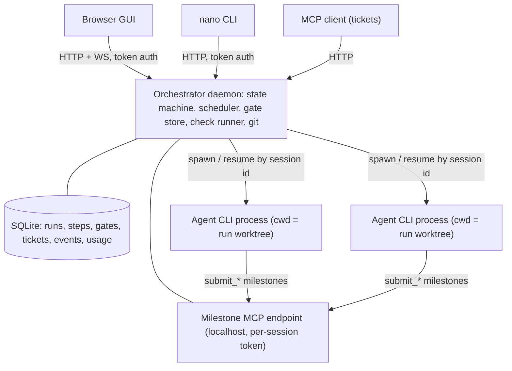

# nano-cycle — Post-mortem and Rewrite Recommendation

**Date:** 2026-10-09  
**Scope:** the whole repository at `4fa5a3b` (host engine, queue, server, GUI, skills, tests, docs), 108 real run records under `runs/`, the two target repos it delivered into (`glm-coding-plan-usage-monitor`, `omni-isp`), the prior analyses in this repo, and current (2026) documentation for Claude Code, Codex, opencode, Antigravity (`agy`), Gemini CLI, pi and ACP.  
**Method:** four parallel deep audits (engine correctness, queue/server/persistence/frontend, run forensics, agent-backend research), plus direct reading of the design docs and code. Bugs below are tagged **C** (confirmed by reading the code or reproducing) or **S** (suspected).  
**Nothing else in the repository was changed.**

---

## 0. The short version

1. **It is not the failure it feels like.** On real projects, every ticket that reached the build step was eventually merged — 10 of 10 on `glm-monitor` and `omni-isp` — using only `glm-5.3-flash`. The v2 engine has had no `ReferenceError`-class crashes since v1. The *ideas* (spec as contract, driver-owned gates, mechanical ground truth, verdict reconciliation, fresh adversarial verifier, builder resumes its own context) are sound and worth keeping.
2. **But it is unreliable by construction, and the bugs are architectural, not careless.** The bug inventory (≈50 items across the two code audits, ~10 critical/high) traces back to six root causes. They are explained in §2: in-process agent sessions that die with the web server, an implicit state machine with two sources of truth, human gates that block *inside* tool calls, git operating in your real checkout, JSON-file stores with sync I/O, and tests that fake exactly the seam where the bugs live.
3. **The gates mostly enforce bookkeeping, not correctness.** Across the 10 merged runs, verify caught **one** functional defect. 4 of 9 fix rounds were spent ticking a `features.md` checkbox, and 3 were spent on a mechanical-check false positive. The audit step returned zero blocking findings in all 10 runs. Wall-clock time is dominated by provider quota (429s), server restarts and unattended owner gates, not by the agents' work.
4. **The pace outran verification.** 121 commits in 14 days, three architectures (v1 DAG → v2 four-step → v3/v3.1 queue), ~39k lines added. Plans were marked "all TODOs done" while six end-to-end flows were broken (`docs/V3-GAP-AUDIT.md`). Each architectural layer was added before the one beneath it was stable.
5. **Recommendation: yes, rewrite — but do not rewrite the same thing with more backends.** Build a **small, durable orchestrator** that:
   - drives agent CLIs (Claude Code, Codex, opencode, pi, any ACP agent; `agy` experimental) **as subprocesses**;
   - runs in **one git worktree per run**;
   - keeps state in **SQLite** with an **explicit state machine**;
   - puts **gates between turns** (submit → end turn → human decides → resume session), never inside a tool call;
   - describes the pipeline as **data** (per-step agent + model + effort + skill + milestone schema).

   Spike the adapters first, build the core headless (CLI only), measure against a plain single-agent baseline, and only then add GUI and queue.
6. **Be honest about the alternative.** The hand-built Claude Code workflow in `omni-isp/.claude/` beat nano-cycle on ~87% of scored dimensions in your own September analysis. The rewrite must include a benchmark that proves the orchestrator beats "one strong agent + good skills". Otherwise, the right product is the skills, not the orchestrator.

### Do these now, regardless of the rewrite decision

| # | Action | Why |
| --- | --- | --- |
| 1 | **Rotate the two Z.AI tokens** that were committed in `glm-coding-plan-usage-monitor` `docs/PRD.md` (`a2819a4`, `177c9b9`) and pushed | Removed from the file by F10's security round, but still in pushed git history |
| 2 | **Never expose the server beyond loopback** (`NANO_HOST=0.0.0.0` is unsafe even behind a TLS proxy) and avoid browsing untrusted sites while it runs | No auth, no Origin/Host/CSRF check: any web page can POST a prompt to a bash-capable chat agent, or start a run on any absolute path (§3.1, S-1) |
| 3 | Push `glm-coding-plan-usage-monitor` `main` (7 commits ahead of `origin/main`) and delete the empty leftover branches `nano-cycle/20260924-223509193` and `nano-cycle/20260921-232120585-wave` (omni-isp) | Delivered work is not backed up |
| 4 | Delete the 628 empty test directories in `runs/` (`test-*`, `hc-*`, `lock-*`, `v3p-*`, `dbg`) | Pre-`c89716b` test pollution; none are real runs |

---

## 1. What the evidence says

### 1.1 Run outcomes

| Engine | Runs | Completed | Failed | Cancelled | Interrupted / other |
| --- | --- | --- | --- | --- | --- |
| v1 DAG (≤ 2026-09-17) | 59 | 32 | 22 | 5 | 4 interrupted |
| v2/v3 step engine (≥ 2026-09-20) | 45 (21 sandbox, 24 real-project) | — | — | — | — |
| ↳ real-project ticket builds | 10 | **10, all ff-merged** | 0 final | — | — |

v1 failures included code bugs that reached the running product: `run is not defined` (×3), `emit is not defined`, `forcedFinalize is not defined`, `unknown node`, `Cannot read properties of undefined (reading 'acceptance_criteria')` (×2). v2 removed that class of crash.

### 1.2 The ten real-project builds (v2/v3)

| Run | Ticket | Wall / active | Fix rounds | What the gates caught |
| --- | --- | --- | --- | --- |
| `20260921-171747224-f06` | F06 | 85m / 85m | 1 | backlog checkbox only |
| `20260921-184227877-f07` | F07 | 72m / 72m | 1 | backlog checkbox |
| `20260921-235823175-f01` | F01 (omni-isp) | 193m / 112m | 3 | `/health` returned JSON (**real**), undeclared deps (**real**), env-wiring ×3 (last one a confirmed false positive) |
| `20260923-022644390-f08` | F08 | 33m / 33m | 0 | — |
| `20260923-025936408-f09` | F09 | 44m / 44m | 1 (cut short by restart) | backlog checkbox |
| `20260923-095426526-f10` | F10 | **2200m** / 107m | 1 + 1 security | real tokens in the owner's PRD; 6× 429; failed and sat 34.5 h |
| `20260924-234905672-f10` | F10 (again) | 26m / 26m | 0 | duplicate build of already-merged work |
| `20260925-001509300-f11` | F11 | 29m / 29m | 0 | — |
| `20260925-004409443-f12` | F12 | 66m / 66m | 1 | backlog checkbox; two 5-hour-cap 429s needing manual resume |
| `20260925-014959139-f13` | F13 | **417m** / 49m | 0 | security "unfixable high" on a gitignored file → **6h07m** waiting for an override |

Median active time is ~55 minutes per ticket. All roles ran on `zai-coding-cn/glm-5.3-flash:high`. Tokens for these 10 runs were 4.65M input, 1.10M output and 125.7M cache-read. No dollar cost is recorded anywhere.

### 1.3 What the gates actually did

- **Verify:** 9 fix rounds in total. 4 were the backlog checkbox, 3 were the F01 env-wiring check (the verifier itself said the flagged line was a doc comment), 1 was the PRD secret, and 1 was a real functional defect (F01 `/health`).
- **Audit:** **0 blocking findings in 10 of 10 runs.** It has never gated anything.
- **Security:** triaged the *same* gitignored `index.html` token file five times. It rated it low/medium four times and "high, unfixable" once, which caused the 6-hour stall.
- **Verdict reconciliation** ("model says accepted, checks say no") never fired, so the verifier was honest. Its job was simply easy.

So the expensive multi-step machinery currently buys you: one real defect caught, one leaked-secret detection, and a lot of bookkeeping churn. That is not an argument against gates. It is an argument for **making deterministic bookkeeping a driver action** (never a fix round), **testing the checks against fixtures**, and **pointing the verifier at behaviour** (§6.8).

### 1.4 Recurring failure modes (v2/v3)

| # | Failure mode | Count | Cause class |
| --- | --- | --- | --- |
| 1 | First `submit_audit` rejected for a missing `verdict` | 12 of 37 calls | schema/prompt design |
| 2 | Fix round spent only on the backlog checkbox | 4 of 9 rounds | engine design |
| 3 | Provider 429 killed the build, reported as "ended without an impl-delta" | 3 failures, 36 retry notices | infra + reporting bug (partly fixed in `4fa5a3b`) |
| 4 | Server restart during a run | 6 events, 5 runs | architecture (§2.1) |
| 5 | `gateWaitMs` = 0 after a 6-hour wait; step `durationMs` inflated (F01 steps sum to 576m against 193m wall) | systemic | metrics bugs |
| 6 | Mechanical-check false positive or over-strict rule | 3 rounds | untested checks |
| 7 | `chore: leftover working-tree changes` commits; milestone commit failed on a gitignored path | 4 commits | git in a shared tree |
| 8 | Restart mid-fix-round skipped the fix, then dirt stalled the queue | 1 (F09) | implicit state machine |
| 9 | Wrong ticket id in commits (`(F05)` on F06 work); subjects cut mid-word | most commits | string heuristics |
| 10 | F10 re-clarified and rebuilt after it was already merged | 3 wasted runs | ticket ↔ run desync |

### 1.5 The development history

| Metric | Value |
| --- | --- |
| Commits | 121 in 14 days (2026-09-12 → 09-25); 47 on 09-21 alone |
| Fix commits | 31 |
| Lines added / removed | ~39.3k / ~9.6k |
| Architectures shipped | v1 tier/DAG with parallel coders → v2 four-step (DAG deleted) → v3 ticket queue → v3.1 single-PM waves |
| Side features | project chat, MCP ticket server, deploy script with searxng/obscura installers, theme system, VAPT, token-hygiene injection |
| Current size | `host/` ≈ 6.6k lines (engine 2,249), `web/src` ≈ 8k lines, tests ≈ 2.5k lines |
| Docs drift | README says the GUI is MUI; the code uses Chakra. `deploy.sh` prints `NANO_PORT=…` but the server reads `PORT`. |

---

## 2. Root causes — why it keeps breaking

These six causes explain almost every item in the bug inventory (§3). A rewrite that fixes them removes whole bug classes. A rewrite that keeps them reproduces the same bugs in new code.

### 2.1 Agent sessions live inside the web server process

pi sessions are created in-process by `host/runner.mjs`, so the server *is* the runtime. Any restart (deploy, crash, code change, OOM) kills every active run. Your own workflow notes forbid restarting during runs for this reason, and six runs record "interrupted by server restart". All the resume machinery (`resumeFromDisk`, the orphan sweep, re-presenting gates, `recoverAll`) exists to compensate. It is where many of the bugs live (engine #1, #18, #20; queue H7).

**Rewrite rule:** agents run as **separate processes** (agent CLIs) whose session ids are durable. The orchestrator can restart at any time and reattach or resume.

### 2.2 The state machine is implicit, and truth lives in two places for each run

- `execute()` (`host/engine.mjs:1506-1812`) is one ~300-line async function inside a ~2,100-line closure. Resume works by re-entering it from the top and skipping phases whose artifact happens to be non-null. Run status is a string set ad hoc in ~15 places.
- **Run truth is split.** `run.state` is persisted. `run.cancelRequested`, `finalized`, `done`, the resolvers, the handles and `holdsTree` are memory-only. Cancel/resume desyncs follow directly — for example, two `execute()` loops running on the same run after cancel → resume (engine #1).
- **Ticket truth is split from run truth.** `tickets/*.json` and `runs/*/state.json` are linked only by in-memory `onSettled` callbacks and a monkey-patched `emit.state`. Every entry point that bypasses the queue (Run now, server resume, delete, restart) breaks the link. V3-GAP-AUDIT A2–A5 and queue H1–H7 are all this one problem.

**Rewrite rule:** one database, explicit states and transitions, every transition a transaction, and a run *epoch* checked after every `await`.

### 2.3 Human gates block inside tool calls

`submit_plan` awaits a promise stored on `run.gateResolver` for as long as the owner takes, potentially hours (`host/engine.mjs:193-210`, `731-800`). Consequences:

- **Every gate needs two implementations:** the live one inside the tool, and a resume re-presentation (`host/engine.mjs:1520-1560`) for when the process died while blocked. They have already drifted. After a resumed plan approval the run can re-plan (engine #13), and the resumed gate doesn't set `awaiting-gate`, so the queue can't park it (engine #3).
- **Ordering bugs.** `emit.state` fires before the resolver is assigned, so the queue's watcher tries to cancel a gate that doesn't exist yet. Gate parking is dead for the second time (queue C3).
- **Every other backend breaks it.** Codex's MCP tool timeout defaults to 60 s, opencode has a reported ~5-minute cap, and Claude Code moves MCP calls that run longer than 2 minutes into the background and keeps working. A tool that blocks for hours is not portable.

**Rewrite rule:** milestone tools **validate, store and return immediately**. The turn ends. The gate is a *run state*. The decision is delivered by **resuming the session with a new prompt**. There is exactly one gate implementation, and it survives restarts for free.

### 2.4 Git runs in your real checkout, shared between overlapping runs

`start()` runs `assertClean` + `checkout -b` in the project's working tree. Clarify-only waves also switch branches while a build holds the tree, while `holdsTree=false` claims otherwise (engine #4, queue C2). `commitLeftovers` runs `git add -A` on whatever branch is checked out, which can commit an un-ignored `.env` (engine #7). Cancel releases the tree lock before `integrate()` finishes its git work (engine #2). The lock itself lives in memory and is checked before several awaits, so two starts can both acquire it (engine #19, queue H6).

**Rewrite rule:** **one `git worktree` per run**, created from a pinned base SHA. The user's checkout is never touched except by an explicit, final merge step.

### 2.5 Storage and I/O are fragile and synchronous

`state.json` is rewritten in full and non-atomically on every state emit. Every streamed token is an `appendFileSync` plus a broadcast to all clients (one log is 57 MB / 710k lines). The ticket and project stores treat a JSON parse error as "empty" and then overwrite the real data. Scanners run via `spawnSync` for up to 5 minutes, freezing the whole server, and mechanical checks walk the tree synchronously. Tests once **wiped the live ticket store** (2026-09-21).

**Rewrite rule:** SQLite (`node:sqlite`, Node 24) for all state, batched event writes, no token-level persistence (coalesce deltas), and all external work async and abortable.

### 2.6 Tests fake exactly the seam where the bugs live

The engine harness (27 scenarios, all green) replaces pi with scripted fakes. `abort()` and `close()` are no-ops, and `prompt()` runs a script that calls tools directly. The queue tests use a fake engine whose `gate()` always succeeds, which is why gate parking can be dead while tests pass. Untested areas include:

- real abort semantics: pi *resolves* on abort and doesn't reject, so `milestoneStop` is effectively dead (engine #12);
- the stall check, which compares against `stopReason === "end"` — a value pi never emits (engine #11);
- cancel/resume races, restarts, concurrent starts;
- the mechanical checks themselves: none of the eight is tested against fixtures, which is where the false positives come from.

**Rewrite rule:** **contract tests against the real agent CLIs** (recorded transcripts plus a small live smoke suite), **fault-injection tests** (`kill -9` mid-step, 429 injection, restart at every state), and **fixture tests for every check**.

### 2.7 Contributing factors (not code)

- **Scope and pace.** Chat, MCP, deploy tooling, VAPT, waves and theming were added while the core state machine was still producing ReferenceErrors and race conditions. "All TODOs done" was declared before live validation (V3-GAP-AUDIT).
- **AI-built and AI-audited.** Plans, implementation and audits were all produced by agents. The audits were good, but they ran *after* "done". Each layer needs a human-run validation gate before the next one starts.
- **Model class.** Your September root-cause analysis found the builder model class was the dominant quality factor, and the whole v2/v3 history ran on `glm-5.3-flash`. The current recorded runs therefore don't show what the pipeline does with a strong builder — another reason for per-step agent/model choice and a proper benchmark.

---

## 3. Bug inventory (highest severity first)

This is not exhaustive. File references are to `4fa5a3b`. **C** = confirmed by reading or reproducing; **S** = suspected.

### 3.1 Critical

| Id | Bug | Where | Tag |
| --- | --- | --- | --- |
| S-1 | **No auth, no CSRF/Origin/Host check on HTTP or WebSocket.** `readBody` parses `text/plain` as JSON, so any web page can POST without a preflight. Unknown chat session ids are auto-created, so one blind POST gets a bash-capable agent. `POST /api/runs` accepts any absolute path. Any site can read every run event over the WebSocket, and DNS rebinding gives full read/write. | `host/server.mjs` (all routes, WS at ~532), `host/chat.mjs:293-299`, `host/projects.mjs:79-81` | C |
| E-1 | Cancel then resume can run **two `execute()` loops on the same run**. Both write to one session JSONL; the old loop's catch can `integrate()` (checkout base) under the new one and settle it. | `host/engine.mjs:256`, `2074`, `2232` | C |
| E-2 | Cancel releases the tree lock before git work finishes, so the next queued run can `checkout -b` mid-commit. A cancel during session load is lost, and a full verifier turn then runs anyway. | `host/engine.mjs:256`, `2063`, `1279`; `host/runner.mjs:323` | C |
| Q-C2 | Clarify waves switch branches in the shared tree while `holdsTree=false`. Builds then branch from and merge into the wave branch, and delivered work ends up off `main`. | `host/engine.mjs:1858-1879`, `1599-1611`, `1960`; `host/queue.mjs:201` | C |
| Q-C3 | Gate parking is dead: `emit.state` fires before `gateResolver` is set, so the watcher's cancel is a no-op. The ticket shows blocked, but the run holds the tree forever and the pump re-schedules every 60 s. | `host/engine.mjs:197/199`, `1537/1539`, `1735/1737`; `host/queue.mjs:98-106` | C |

### 3.2 High

| Id | Bug | Where | Tag |
| --- | --- | --- | --- |
| E-3 | Security-override and resumed plan gates never set `awaiting-gate`, so the queue cannot park them | `host/engine.mjs:1730-1742`, `1524-1544`; `host/queue.mjs:92` | C |
| E-5 | Fix rounds never clear `artifacts.implDelta`, so the "ended without a new impl-delta" guards can never fire and verify judges stale claims | `host/engine.mjs:1036`, `1055`, `1665`, `1696`, `1757` | C |
| E-6 | `spawnSync` scanners block the entire server for up to 5 minutes | `host/engine.mjs:1331`, `1376` | C |
| E-7 | `commitLeftovers` runs `git add -A` in the user's checkout on every integrate, including after cancel | `host/engine.mjs:307-335` | C |
| E-8 | Milestone commits are fire-and-forget, so remote CI can be watching an older SHA | `host/engine.mjs:283`, `1104`, `1117` | C/S |
| E-9 | `prockill` skips processes whose cwd *is* the project root (the common case), kills other runs' processes, and blocks with `Atomics.wait` | `host/prockill.mjs:63`, `88` | C |
| E-10 | A foreground `npm run dev` hangs the run forever: the watchdog pauses during tool calls and pi `bash` has no default timeout | `host/runner.mjs:189` | C |
| Q-H1 | A re-pump from inside the pump is swallowed by `pumpInFlight`, so the next ticket never starts (reproduced) | `host/queue.mjs:256-260`, `282`, `289` | C |
| Q-H2 | Completing a dependency un-blocks *unreleased* draft/clarified tickets straight to `queued`, bypassing the release gate (reproduced) | `host/queue.mjs:401-412`, `448-457` | C |
| Q-H3 | One stuck head ticket stalls the whole queue | `host/queue.mjs:277`, `291-300` | C |
| Q-H4 | "Run now" and `POST /api/runs/:id/resume` bypass the queue, so tickets stay draft/queued after their run completes | `host/server.mjs:500-508`; `TicketsView.tsx` `runNow` | C |
| Q-H5 | Non-atomic whole-file writes. A parse error reads as an empty store and the next write destroys the data. A truncated `state.json` disappears from `listRuns`. | `host/tickets.mjs:46-55`, `host/state.mjs:27-29`, `host/projects.mjs:17-31` | C |
| Q-H6 | The tree lock is checked before awaits, so two concurrent starts both acquire it. In-session `resume()` has no lock check at all. | `host/engine.mjs:1858-1970`, `~2068` | C |

### 3.3 Medium (selection)

- Engine #11: the stall check compares against `stopReason === "end"`, which pi never emits, and `lastStall` is never reset — `host/runner.mjs:340`.
- Engine #12: `safePrompt`'s abort assumption is wrong (pi resolves rather than rejects), and fix rounds capture a stale controller — `host/engine.mjs:697-716`, `978`.
- Engine #13: after a plan-gate resume the run can re-plan and re-gate; the reject path labels the first commit `fix:` — `host/engine.mjs:1033`, `1550`, `1624`.
- Engine #14: a missing `submit_audit` counts as a pass — `host/engine.mjs:1187`, `1319`.
- Engine #15: the verifier system prompt contains `undefined/SKILL.md` (`skillDirs.audit` vs `auditDeliverables`) — `host/prompts.mjs:180`.
- Engine #16: code changed by a security fix round is never re-verified — `host/engine.mjs:1755`.
- Engine #18: pending clarify questions are lost after a server restart — `host/engine.mjs:2238`.
- Engine #21: `completed` is set before `integrate()`, so a failed merge still reads "completed" — `host/engine.mjs:1772`.
- Engine #22: mechanical-check false positives:
  - `readme-commands` mishandles `-w packages/x` — `host/checks.mjs:534`;
  - `env-wiring` doesn't see compose, destructuring or `process.env[k]` usage;
  - the i18n check treats any pair of two-letter `.json` files as a locale set.
- Path-prefix checks without a separator: `startsWith(projectPath)` lets `../app-secrets` through — `host/backlog.mjs:171`, `host/queue.mjs:477`.
- `runDir()` creates directories as a side effect of reads (this is how `runs/` filled with test dirs) — `host/state.mjs:15-19`.
- Sessions are never disposed (no `dispose` anywhere in `host/`), so agent state and bash children leak per verify/security round.
- Chat errors are thrown after the server has answered `{ok:true}`, so the UI spins forever — `host/chat.mjs:440-445`.
- Frontend:
  - the WebSocket reconnects on every run switch, and there is no reconnect after a restart (`App.tsx:162-188`, `api.ts:422-433`);
  - no request ordering on `loadRun`;
  - `TicketRow` snapshots props into state, so Save overwrites newer server data;
  - ChatView writes the previous project's model into the new project's storage key;
  - every token copies a 3,000-element array and re-groups the console.
- `deploy.sh`:
  - the start hint says `NANO_PORT` but the server reads `PORT`;
  - the systemd unit requires `.env`;
  - `auth.json` is written before `chmod 600`;
  - searxng and obscura are unpinned.

---

## 4. What is worth keeping

The rewrite should **harvest**, not discard. These pieces earned their place in the run history or are good designs on paper:

| Keep | Source | Notes |
| --- | --- | --- |
| **Driver owns law, skills own method** | README, PLAN-v2 | The core philosophy is right |
| Milestone **schemas** (spec with `ac_verification` local/remote/human, plan, tasks, impl-delta with `task_completion`, verify, audit with `blocking`, security with `fixable_in_scope`) | `host/config.mjs` | Port to JSON Schema / Zod so every backend can consume them |
| `validateTasks`: slug ids, dependency existence and cycles, **shared file ⇒ dependency path** | `host/config.mjs` | Pure function; easy to test |
| Verdict reconciliation (checks override the model's verdict; env-limited remote/human criteria become non-gating deferrals) and the severity gate (fixable vs unfixable → owner) | `host/engine.mjs:1151-1196`, `1437` | Extract as pure functions with table tests |
| Fix turns that name the owning task and re-state the plan, tasks and ACs (compaction-proof) | `host/prompts.mjs` `builderFeedbackTurn` | |
| One persistent builder session across fix rounds + a fresh adversarial verifier per round | PLAN-v2 amendment 1 | Maps directly to "resume session id" on every CLI |
| `requireQuestions` withholds `finalize_spec` structurally | `host/engine.mjs` clarify | Tool availability is enforcement; prompts aren't |
| Pending gate payloads persisted before blocking (resume costs zero tokens) | engine | Becomes natural with between-turn gates |
| The 8 bundled skills (~800 lines), especially `verification` and `audit-deliverables`; `markdown-writer` | `skills/` | Agent-agnostic `SKILL.md` format works in Claude Code, opencode, Codex and pi |
| Clarify prompt craft: owner-only questions, source-doc traceability, repo rules promoted to ACs, AC environment tagging | `host/prompts.mjs` `clarifySystem` | |
| Mechanical checks **as ideas**: `deps-declared`, `no-cdn-fonts`, compose env/pins, README command truth, gitleaks, remote-CI-by-SHA with failed-log excerpts. Policy: "skips never gate, failures do" | `host/checks.mjs`, `host/ci.mjs` | Rewrite each with fixtures; add a per-check "advisory" level |
| Ticket model (statuses, `blockedReason` set, history), "gates park tickets, not the queue", spec stored outside the target repo, re-clarify seeded with the old spec + park reason | `host/tickets.mjs`, `host/queue.mjs` | Model as DB rows inside the same state machine as runs |
| MCP ticket server design: thin HTTP client, "the agent is the parser", idempotent bulk import | `host/mcp-tickets.mjs` | Add gate/cancel tools and proper JSON-RPC errors |
| UX: PM Inbox across runs, gate cards with recommended answers, review tab, console grouping, deep-link persistence | `web/src` | Reuse visual components, not the data layer |
| Token-hygiene injection, rules lookup (`.claude/rules` wins over `.pi/rules`), capability probing at boot | `host/token-hygiene.mjs`, `host/rules.mjs` | |

**Discard:** the engine closure, the runner, the JSON stores, the queue's callback wiring, `prockill`, the server's regex router, the GUI's data layer (≈30 `useState`s in `App.tsx`, a CustomEvent bus, polling), and the test harness's fake pi layer.

---

## 5. Options considered

| Option | What it means | Verdict |
| --- | --- | --- |
| **A. Keep patching** | Fix the ~50 bugs in place | **No.** The root causes in §2 regenerate bugs faster than they're fixed (31 fix commits in 14 days). It also leaves you locked to pi. |
| **B. Incremental refactor** | Extract a state machine, add worktrees, move to SQLite, out-of-process agents, between-turn gates | Possible, but it touches every module and every persisted format. Total cost is close to a rewrite while carrying v1–v3 compatibility baggage. |
| **C. Rewrite as a thin, durable, multi-backend orchestrator** | §6. The agent CLIs do the agentic work; the orchestrator owns state, gates, checks, git and the UI. | **Recommended.** It matches your goals (multiple agents, per-step model choice) and removes the root causes by construction. |
| **D. Don't orchestrate — package the method** | Claude Code (or any agent) + the reference skills/agents/rules, a few hooks, a thin runner script, maybe an existing board UI (vibe-kanban-style) | **Use as the benchmark.** If C cannot beat D on a fixed ticket set, the orchestrator isn't paying for itself and D is the product. |

The recommendation is **C, measured against D from the first week**. The skills you write for C are useful to D anyway, so neither path wastes them.

---

## 6. Target architecture for the rewrite

### 6.1 Principles

1. **The orchestrator is a durable state machine, not an agent runtime.** Agents are external processes. The orchestrator never holds the only copy of anything in memory.
2. **One gate implementation: between turns.** A milestone submission ends the turn. Decisions arrive as the next prompt on the same session.
3. **Isolation by default.** One worktree per run, one branch per run, and the base is touched only by an explicit merge step.
4. **The pipeline is data.** Steps, agents, models, skills, schemas and gates are configuration. Per-step agent/model choice falls out of this.
5. **Deterministic work is done by the driver.** Backlog flips, commit messages and formatting are never fix rounds.
6. **Everything external is async, abortable and time-boxed:** agents, checks, scanners, git, CI watch.
7. **Lowest common denominator first.** Build against the features every backend shares (headless run, JSONL events, resume by id, per-session MCP or structured output). Use native extras only through capability flags.

### 6.2 Process topology



- The daemon can be restarted at any time. On boot it reconciles each running step: if the agent process is still alive, it re-attaches to the stream; otherwise it resumes the session by id with a "continue" prompt or marks the step interrupted, according to the step's idempotency.
- Agent processes write their raw stream to `runs/<id>/steps/<step>/<attempt>.jsonl` (cheap append, owned by a small reader) so nothing is lost while the daemon is down.
- The GUI is a pure client. It subscribes per run, and token deltas are coalesced into the stream at ~10 Hz rather than persisted one by one.

### 6.3 State model (SQLite)

```text
projects(id, name, path, created_at)
tickets(id, project_id, ext_id, title, body, deps_json, status, blocked_reason, spec_run_id, order, ...)
runs(id, project_id, ticket_id, pipeline_json, status, epoch, base_sha, branch, worktree_path, error, ...)
steps(id, run_id, def_id, attempt, status, agent, model, effort, session_id, started_at, ended_at, usage_json, error)
artifacts(id, run_id, step_id, kind, version, payload_json, created_at)          -- append-only
gates(id, run_id, step_id, kind, payload_json, status, decision_json, opened_at, decided_at)
events(id, run_id, step_id, ts, type, payload_json)                                -- batched inserts
locks(resource, holder_run_id, epoch, acquired_at)                                 -- e.g. 'project:<id>:merge'
```

- **Run statuses** form one enum with an explicit transition table, enforced in one module:
  `queued → preparing → running(step) → awaiting_gate | awaiting_answers | paused_quota → … → merging → done | failed | cancelled`.
  Ticket statuses derive from or update within the same transaction.
- **Epochs.** Every transition bumps `runs.epoch`. Every async continuation captures the epoch and aborts if it changed, which kills the "two loops" class (E-1).
- **Artifacts are versioned and append-only.** A step "has produced X" means *an artifact of kind X created in this attempt*. That eliminates stale-artifact bugs (E-5, engine #20).
- **Waits are rows.** Gates, answers and quota pauses are rows, so a restart re-presents them with zero logic.

### 6.4 Pipeline definition (data, per step agent + model)

```yaml
# pipelines/default.yaml
name: default
steps:
  - id: clarify
    optional: true
    agent: claude-code            # adapter id
    model: claude-opus-5-5
    effort: high
    skills: [product-management]
    tools: read-only              # policy mapped per adapter
    milestones: [ask_questions, finalize_spec]
    gate: answers                 # human, between turns
  - id: build
    agent: codex
    model: gpt-5.x-codex
    effort: high
    session: persistent           # fix rounds resume this session
    skills: [planning, task-breakdown, implementation]
    tools: workspace-write
    milestones: [submit_plan, submit_tasks, submit_impl_delta]
    gates:
      submit_plan: { approval: owner, when: "options.approvePlan" }
  - id: verify
    agent: claude-code            # a different vendor than the builder: uncorrelated blind spots
    model: claude-sonnet-5-5
    session: fresh-per-round
    skills: [verification, audit-deliverables]
    tools: read-only+exec
    pre: [checks.mechanical, checks.remote-ci]
    milestones: [submit_verify, submit_audit]
    on_gaps: { resume: build, max_rounds: 2 }
  - id: security
    optional: true
    agent: opencode
    model: zai/glm-5.3
    pre: [scanners]
    milestones: [submit_security]
```

The GUI's "pick agent and model per step" is an editor over this document, with saved **profiles** (`fast-cheap`, `max-quality`, `cross-vendor`). The engine validates every pipeline against adapter capabilities before starting. For example, verify requires an adapter that can enforce read-only, and a gate on `submit_plan` requires session resume.

### 6.5 The agent adapter interface

```ts
interface AgentAdapter {
  id: string;                                   // "claude-code" | "codex" | "opencode" | "pi" | "acp:<agent>" | "agy"
  probe(): Promise<Capabilities>;               // installed? version? auth ok? models list?
  start(spec: SessionSpec, signal: AbortSignal): AgentRun;
  resume(sessionId: string, prompt: string, spec: SessionSpec, signal: AbortSignal): AgentRun;
}

interface Capabilities {
  resume: boolean; mcpPerSession: boolean; structuredOutput: boolean;
  readOnlyEnforced: boolean; costUsd: boolean; tokenUsage: boolean;
  maxToolCallMs?: number; models: string[]; efforts?: string[];
}

interface SessionSpec {
  cwd: string;                  // the run worktree
  model: string; effort?: string;
  systemPrompt: string;         // driver-assembled: rules + skill pointers + token hygiene
  prompt: string;
  toolPolicy: "read-only" | "read-only+exec" | "workspace-write";
  mcp: { url: string; token: string; tools: string[] };   // the milestone endpoint
  outputSchema?: JSONSchema;    // fallback when MCP is unavailable
  env: Record<string, string>; timeoutMs: number;
}

interface AgentRun {
  events: AsyncIterable<NormalizedEvent>;      // text | thinking | tool_start | tool_end | usage | error | done
  sessionId: Promise<string>;
  result: Promise<{ stopReason: "end" | "aborted" | "error" | "quota"; usage: Usage }>;
  cancel(): Promise<void>;                     // kill the process group, not just a flag
}
```

Each adapter is roughly 200–400 lines: spawn, parse JSONL, map events, map the tool policy to that CLI's flags, and write the MCP config the way that CLI accepts it. **Contract tests** run the same scripted scenario against every installed adapter: run, submit a milestone, end the turn, resume with a decision, cancel mid-tool, report usage.

### 6.6 Milestone tools without blocking

```text
agent ── submit_plan(json) ──▶ orchestrator MCP endpoint
                                 ├─ validate (JSON Schema + validatePlan)
                                 ├─ invalid → return errors as tool result (agent fixes and resubmits, same turn)
                                 └─ valid   → store artifact v(n), open gate row, return
                                              "Plan recorded. STOP NOW — end your turn."
agent ends turn ─▶ adapter result: stopReason=end ─▶ run status = awaiting_gate
owner decides (GUI / CLI / MCP) ─▶ adapter.resume(sessionId, "APPROVED — continue with task breakdown…")
                                 or adapter.resume(sessionId, "REJECTED: <comments> — revise and resubmit")
```

- The MCP endpoint is one localhost streamable-HTTP server owned by the daemon. Each session gets a token that binds its calls to `(run, step, attempt, epoch)`. Calls with a stale epoch are rejected.
- If an agent keeps working after "STOP NOW", the orchestrator cancels the process once the artifact is stored. That's safe, because the artifact is durable and the session can be resumed.
- **Fallback for backends without per-session MCP:** use the CLI's structured final output (`claude -p --json-schema`, `codex exec --output-schema`, `agy -p --json-schema`) to carry the milestone in the turn's last message.
- **Short in-turn approvals** while you watch (e.g. "allow this destructive command?") can use each backend's native permission hook: Claude `canUseTool`/`PermissionRequest`, Codex approval requests, ACP `session/request_permission`. Owner gates measured in hours never should.

### 6.7 Git and workspace

- `git worktree add <runs>/<id>/wt -b nano/<id> <base_sha>` at run start. Agents' cwd is the worktree.
- Milestone commits are awaited and commit **explicit paths reported in the impl-delta**, plus a driver-computed diff check. Unexpected files make the commit fail loudly instead of being swept up by `git add -A`.
- Leftover handling is a visible gate inside the worktree, never a silent commit.
- Merge is its own step: hold the project merge lock (a DB row), fast-forward or rebase the base, then run the backlog flip as a driver commit. On failure the branch is kept and a gate is opened.
- Worktrees make **parallel tickets** safe later (vibe-kanban, Conductor and claude-squad all converged on this). Keep the queue sequential at first anyway.
- Dev servers and compose stacks started by agents need unique ports and project names per worktree. Track them, and kill them by process group or compose project at step end.

### 6.8 Checks and gates that catch defects instead of bookkeeping

- Every check is a module with `run(worktree, signal) → {status: pass|fail|warn|skip, findings[]}`, runs in a child process, and has **fixture tests** (a passing repo, a failing repo, and known false-positive shapes).
- Each check has a level, `gating` or `advisory`, configurable per project. New checks start **advisory** until they have run clean on real projects.
- **Bookkeeping is a driver action:** backlog flip, `features.md` status, changelog and commit message format. Never spend a fix round on it.
- Point the verifier at **behaviour**. It should run the app, run the tests cold, and probe ACs, with per-AC evidence required by the schema. Make `submit_audit` mandatory (it is silently optional today).
- **Cross-vendor verification:** builder on vendor X, verifier on vendor Y. Correlated blind spots are the main weakness of self-verification; multi-backend support turns that into a feature.
- Security triage should be **deterministic first**: dedupe findings by fingerprint across runs, remember owner decisions (accepted risk) per fingerprint, and never re-ask about the same gitignored file. That alone would have removed the 6-hour F13 stall.

### 6.9 Quotas, failures and cost

- Classify adapter errors as `quota` (429, 5-hour caps), `auth`, `provider`, `tool` or `model`. A `quota` error moves the run to `paused_quota` with a resume-at time parsed from the error when available, and auto-resumes then. It is never a failure.
- Record usage per step from each CLI's native reporting: Claude `total_cost_usd`, Codex `turn.completed` usage, and token counts elsewhere. Compute cost from a price table where the CLI doesn't report dollars.
- Watchdogs: a per-step wall-clock budget and a no-output budget. Tool calls get their own budget, because a hung `npm run dev` must be killable.

### 6.10 Security baseline

- A random bearer token generated at first boot (printed once, stored `0600`) is required on HTTP and WebSocket, and the GUI gets it through a one-time login link.
- Check `Origin` and `Host` on every request. Reject `text/plain` JSON. Validate every body against a schema with a size cap.
- Projects come from an allowlist (the registry), never from arbitrary absolute paths in requests. Path containment uses `path.relative`, not `startsWith`.
- For Claude Code, run with `--bare` or an explicit settings file. Without it, `-p` executes the target repo's `.claude/settings.json` hooks and `.mcp.json` servers with no trust prompt, which matters if you ever run on repos you didn't write.

---

## 7. Multi-backend support — what is realistic in 2026

Condensed from the research audit. Versions move fast: pin them and probe capabilities at runtime.

| | Claude Code | Codex | opencode | pi | Gemini CLI | Antigravity `agy` |
| --- | --- | --- | --- | --- | --- | --- |
| Headless | `claude -p --output-format stream-json`; Agent SDK (TS/Py) | `codex exec --json`; `app-server` (JSON-RPC); TS SDK | `opencode run --format json`; `serve` (HTTP + SDK) | `--mode json` / `--mode rpc`; TS SDK | `-p -o stream-json` | `agy -p --output-format stream-json`; Python SDK (preview) |
| Resume by id | `--resume <id>` | `codex exec resume <id>`; `thread/resume` | `--session <id>` | `SessionManager` | `--resume <id>` | `--conversation <id>` |
| Model per step | `--model` | `--model`, `-c` | `--model provider/model` (any provider) | any provider | `-m` | `--model`, `--effort` |
| Per-session MCP | **`--mcp-config` (inline JSON)** | `-c mcp_servers.*` / `--profile` (verify syntax) | `OPENCODE_CONFIG_CONTENT` | extension in SDK | write `.gemini/settings.json` | write `.agents/mcp_config.json` into the worktree |
| Structured output fallback | `--json-schema` | `--output-schema` | — | custom tools | — | `--json-schema` |
| Default MCP tool timeout | ~28 h wall clock, but **auto-backgrounds after 2 min** | **60 s** (`tool_timeout_sec`) | 60 s–5 min (reported caps) | n/a (in-process) | 600 s | unknown |
| Cost / usage | `total_cost_usd` + tokens | tokens | tokens/cost (unverified) | tokens | tokens | tokens |
| ACP | via adapter | via adapter | **native** | via adapter | **native** (`--acp`) | community only |
| Subscription automation | Your own login on the **unmodified `claude` binary** is OK. **Agent SDK / third-party products: API key only** (enforced since 2026-04-04). | ChatGPT plan tolerated (official token-sharing path); API key recommended | your provider keys / OAuth | depends on provider | API key / Vertex AI only | **Riskiest.** Only the official binary using its own cached login; third-party OAuth use has led to bans. Known `-p` bugs: permission rules ignored, silent output on quota errors. |

**Implications for the design:**

- Because no backend reliably supports an MCP call that blocks for hours, **between-turn gates (§6.6) are mandatory, not a preference.**
- Per-session milestone injection is easiest on Claude Code (`--mcp-config`) and opencode (`OPENCODE_CONFIG_CONTENT`). For Gemini and `agy`, write config files into the worktree; per-run worktrees make that safe.
- **ACP** (agentclientprotocol.com, stable v1; TS/Rust SDKs at 1.0 since June 2026) standardizes sessions, prompts, streamed tool calls, permissions and — crucially — **client-supplied `mcpServers` on `session/new`**. A generic `acp:<agent>` adapter gives you Gemini CLI, opencode, Goose, Cline, Kiro, Qwen, Factory Droid, Copilot and others with one implementation. Keep **native** adapters for Claude Code and Codex, because ACP doesn't carry cost or structured-output features and adapters lag the CLIs.
- **The Claude adapter should drive the `claude` CLI, not the Agent SDK**, if you want to use your Max subscription personally. Offer API-key mode for anything shared.
- **Order of adapters:**
  1. Claude Code CLI
  2. Codex (`exec` first, `app-server` later for `dynamicTools`)
  3. opencode
  4. pi (keeps your GLM/zai setup working)
  5. generic ACP
  6. `agy`, behind an "experimental, ToS-risk" flag

### Prior art to read (not to adopt wholesale)

| Project | What to learn |
| --- | --- |
| vibe-kanban (community-maintained since 2026-04) | Executor + profile model for ~10 agent CLIs, worktree per task, model variants per agent |
| Conductor, claude-squad | Worktree-per-agent isolation, reusing existing CLI logins |
| Sculptor (Imbue) | Container isolation instead of worktrees, for when dev stacks collide |
| coder/agentapi | PTY wrapping as a last resort for agents without a headless mode |
| cligent, Headless Coder SDK | Normalized event schemas across Claude/Codex/Gemini (reference only; not mature enough to depend on) |

---

## 8. Scope for the rewrite

### MVP (must have)

- The daemon with its SQLite state machine, worktrees, the milestone MCP endpoint and between-turn gates.
- Three adapters: Claude Code CLI, Codex `exec`, opencode or pi.
- The pipeline YAML with per-step agent/model/effort.
- Steps: clarify (optional) → build (plan gate) → verify with fix rounds → merge.
- 4–5 mechanical checks rewritten with fixtures, all advisory except gitleaks and tests-pass.
- A CLI: `nano run`, `nano status`, `nano gate approve|reject`, `nano answer`, `nano resume`, `nano cancel`.
- A minimal read-mostly GUI: run list, live console, artifacts, gate/answer cards.
- Auth token, Origin/Host checks.
- A benchmark harness (§9, Phase 3).

### Later (only after the MVP passes the benchmark)

- The ticket backlog and sequential queue, built as DB rows on the same state machine (not a layer of callbacks).
- The security step with scanner triage and decision memory; VAPT after that.
- The generic ACP adapter and `agy`.
- Remote CI watch.
- Parallel tickets across worktrees.
- The MCP ticket server.

### Cut (or keep separate)

- **Project chat.** Every supported agent already has a better interactive UI; just open it in the worktree.
- **The deploy script with searxng/obscura installers.** Document prerequisites instead, and let the agents use their own web tools.
- **Theme system and keyboard keycaps.** Polish after correctness.
- **Single-PM clarification waves.** Revisit once the single-ticket clarify is solid.

---

## 9. Phased plan with exit criteria

Each phase ends with a **human-run validation**, not an agent-declared "done". No phase starts until the previous exit criteria are met.

| Phase | Work | Exit criteria |
| --- | --- | --- |
| **0. Freeze and harvest** (1–2 days) | Do the "now" actions (§0). Tag `v3.1-final`. Extract the schemas, validators, reconciliation, prompts and skills into a `harvest/` folder of pure modules with unit tests. Write ADRs for the §6 principles. | Harvested modules have table tests. The old server stays usable for real work meanwhile. |
| **1. Adapter spike** (3–5 days) | Throwaway scripts per backend (Claude Code, Codex, opencode, pi, Gemini or `agy`), each proving: headless run in a worktree, a per-session MCP milestone call, end turn, resume by id with a decision prompt, cancel by process group, usage reporting, read-only enforcement. | A go/no-go capability matrix from real runs (replacing the "unverified" cells in §7), and at least 3 backends passing every row. |
| **2. Core, headless** (1–2 weeks) | Daemon, SQLite schema, transition table, epochs, worktrees, adapters with contract tests, milestone endpoint, pipeline YAML, CLI. No GUI. | The clarify → build → verify → merge pipeline completes on the sandbox from the CLI. **Fault-injection suite green:** `kill -9` the daemon in every state and the run continues or resumes correctly; 429 injection gives `paused_quota` then auto-resume; cancel/resume races; concurrent starts. |
| **3. Benchmark** (3–5 days, then continuous) | A fixed set of 8–12 tickets on 2–3 sandbox repos with hidden acceptance tests (some greenfield, some brownfield, one deliberately ambiguous). Compare: (D) single agent + skills via plain `claude -p` / `codex exec`, versus (C) the pipeline under 2–3 per-step model profiles. | A table of pass rate on hidden tests, human interventions, wall time and cost. **C must beat D on pass rate at acceptable cost, or you stop and ship D.** |
| **4. GUI** (1 week) | Rebuild on the daemon API: run list, console (coalesced stream), artifacts, gates/answers, pipeline/profile editor with capability validation. Reuse the existing visual components. | Owner runs 3 real tickets through the GUI with no CLI fallback needed. |
| **5. Queue** (1 week) | Tickets as rows; release gate; sequential pump inside the state machine; backlog import (keep the MCP "agent is the parser" path). | W1–W8-style validation passes, including restarts mid-queue. |
| **6. Security and extras** | Scanners with fingerprint memory, ACP adapter, remote CI, parallel worktrees. | Each feature behind a flag, with its own validation. |

---

## 10. Engineering practices so this doesn't repeat

1. **TypeScript, strict mode,** for the daemon and adapters. Most v1 crashes (`run is not defined`, `emit is not defined`) and several v2 bugs (`skillDirs.audit` → `undefined`) are type errors.
2. **Small modules with hard boundaries.** Aim for no file over ~400 lines. The state machine module is the only place a status changes.
3. **Test the seams, not just the logic:**
   - adapter contract tests against real CLIs (recorded and replayable, plus a nightly live run);
   - fault injection for every state;
   - fixtures for every check;
   - property tests for the transition table.
4. **Tests never touch live data.** Every path comes from config, test config uses temp dirs, and read paths have no side effects (no `mkdir` in `runDir()`).
5. **One architectural change at a time,** live-validated before the next one starts. v1→v2→v3 happened in nine days.
6. **An agent's "done" is a claim, not evidence** — the principle your own verification skill already states. Apply it to building nano-cycle itself: owner-run validation scripts gate each phase.
7. **Measure.** Every run records per-step cost, wall time, active time, gate wait time (correctly) and why each fix round happened. Review the numbers weekly, and cut steps that never change outcomes (today, that would include audit).
8. **Keep docs generated or minimal.** README claims (MUI, `NANO_PORT`) drifted within days. Prefer `nano --help` and schema-derived docs.

---

## 11. Final recommendation

Rewrite, with discipline:

- **Keep the philosophy and the harvested parts** (§4). They are the real value from the last month.
- **Change the architecture in exactly the six places that generate bugs** (§2): out-of-process agents, an explicit persisted state machine, between-turn gates, worktrees, SQLite with async I/O, and real-seam tests.
- **Make multi-backend support the foundation, not an add-on.** An adapter interface plus a milestone MCP endpoint plus a pipeline-as-data definition gives per-step agent and model choice almost for free, and enables cross-vendor verification.
- **Cut scope hard** (§8). Build headless first. **Benchmark against a single strong agent with your skills from week one** (§9, Phase 3).

If the benchmark shows the pipeline beating a plain agent, you'll have a tool that is genuinely better than what you'd get by just running Claude Code or Codex yourself. If it doesn't, you'll have found out in about three weeks instead of three more months, and the skills, schemas and checks you harvested become the product.

---

## Appendix A — Evidence index

| Evidence | Location |
| --- | --- |
| Run records (state, events, sessions) | `runs/<id>/` — key runs: `20260921-235823175-f01`, `20260923-095426526-f10`, `20260925-014959139-f13`, `20260923-025936408-f09` |
| v1 crash runs | `20260912-124731828` (`run is not defined`), `20260912-140714051` (`emit is not defined`), `20260912-145558983` (`forcedFinalize is not defined`) |
| Prior root-cause analysis (v1) | `PIPELINE-VS-REFERENCE-ROOT-CAUSE-ANALYSIS.md`, `comparison.md`, `draft.md`, `FIX-REPORT.md` |
| v2 / v3 designs and audits | `docs/PLAN-v2-step-workflow.md`, `docs/PLAN-v3-ticket-queue.md`, `docs/PLAN-v3.1-single-pm-waves.md`, `docs/V3-GAP-AUDIT.md` |
| Reference Claude Code workflow | `/home/munna/sonic/localhost/omni-isp/.claude/` (skills, agents, rules ≈ 2.5k lines) and `omni-isp/WORKFLOW-AUDIT.md` |
| Target repos | `glm-coding-plan-usage-monitor` (`main` 7 ahead of origin; leaked tokens in history), `omni-isp` (F01 merged and pushed) |

## Appendix B — External references (2026)

- Claude Code headless: <https://code.claude.com/docs/en/headless> · MCP timeouts and auto-backgrounding: <https://code.claude.com/docs/en/mcp> · Agent SDK: <https://code.claude.com/docs/en/agent-sdk/overview> · subscription/ToS: <https://code.claude.com/docs/en/legal-and-compliance>
- Codex non-interactive: <https://learn.chatgpt.com/docs/non-interactive-mode> · app-server: <https://learn.chatgpt.com/docs/app-server> · MCP config: <https://learn.chatgpt.com/docs/extend/mcp?surface=cli>
- opencode CLI / server / SDK / config: <https://opencode.ai/docs/cli/>, <https://opencode.ai/docs/server/>, <https://opencode.ai/docs/sdk/>, <https://opencode.ai/docs/config/>
- Antigravity CLI headless: <https://antigravity.google/docs/cli/headless/> · MCP: <https://antigravity.google/docs/mcp/> · FAQ/terms: <https://antigravity.google/docs/faq/>
- Gemini CLI headless and ACP mode: <https://geminicli.com/docs/cli/headless/>, <https://geminicli.com/docs/cli/acp-mode/>
- pi SDK / RPC: <https://github.com/earendil-works/pi/blob/main/packages/coding-agent/docs/sdk.md>, <https://github.com/earendil-works/pi/blob/main/packages/coding-agent/docs/rpc.md>
- Agent Client Protocol: <https://agentclientprotocol.com/protocol/session-setup>, <https://agentclientprotocol.com/overview/agents>
- vibe-kanban: <https://github.com/BloopAI/vibe-kanban> · claude-squad: <https://github.com/smtg-ai/claude-squad> · agentapi: <https://github.com/coder/agentapi>

Unverified items (flagged by the research audit; confirm in Phase 1): the exact `codex -c mcp_servers.*` syntax and any `tool_timeout_sec` maximum; `agy`'s MCP tool timeout and whether `--print-timeout` is now unlimited; whether Claude Code's 2-minute auto-backgrounding applies in `-p` mode; opencode cost fields; the long-term maintenance of Gemini CLI.
